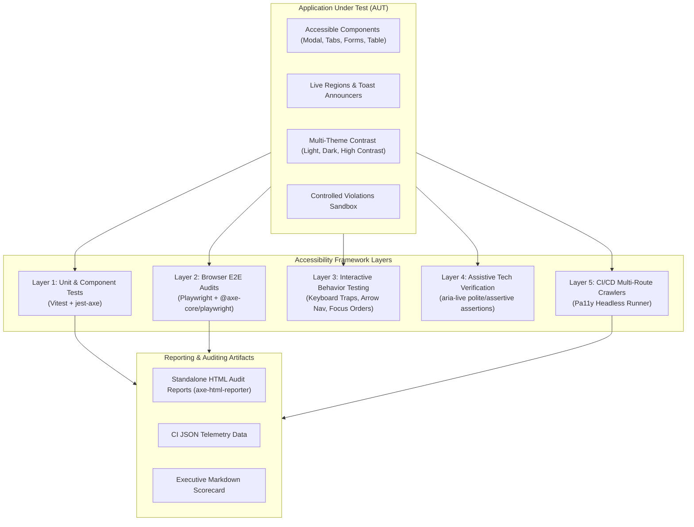

# Enterprise Accessibility (A11y) Testing Framework

A comprehensive, production-grade accessibility testing framework built for modern web applications. Designed to validate compliance against **WCAG 2.0, 2.1, and 2.2 (Level A & AA)** standards, **Section 508**, and **W3C WAI-ARIA 1.2** patterns using industry-standard tools: **Axe-core**, **Playwright**, **Vitest**, **Jest-axe**, and **Pa11y**.

Includes a complete **Application Under Test (Apex Financial Portal)** featuring real-world complex patterns (modal dialog focus trapping, WAI-ARIA tabs, dynamic error validation, accessible data tables, live region announcements, theme contrast switching, and an intentional defects sandbox for negative testing).

---

## 🏗️ Architecture Overview

The framework employs a **defense-in-depth testing strategy** across the software development lifecycle:



---

## 🎯 WCAG 2.1 / 2.2 Criteria & Scenarios Tested

| Category | WCAG Criterion | Implementation & Test Scenario |
| :--- | :--- | :--- |
| **Bypass Blocks** | **2.4.1 (Level A)** | `SkipLink` component: Tab key surfaces skip link; Enter moves focus directly into `#main-content`. |
| **Focus Order** | **2.4.3 (Level A)** | `ModalDialog` focus trap: Tab cycles through modal elements without escaping into background DOM. |
| **Focus Visible** | **2.4.7 (Level AA)** | Universal `:focus-visible` ring verification on all interactive elements. |
| **Focus Appearance** | **2.4.11 (Level AA - 2.2)** | Minimum 3px contrast outline with offset for keyboard navigation. |
| **Keyboard Nav** | **2.1.1 (Level A)** | WAI-ARIA Tabs widget: Left/Right arrow keys cycle active tabs; Home/End jump to boundaries. |
| **Info & Relationships** | **1.3.1 (Level A)** | Semantic landmarks (`header`, `nav`, `main`, `footer`), table `<caption>`, `<th scope="col/row">`, `<fieldset>` / `<legend>`. |
| **Contrast Minimum** | **1.4.3 (Level AA)** | Automated color contrast verification across Light, Dark, and High-Contrast themes (>= 4.5:1). |
| **Contrast Enhanced** | **1.4.6 (Level AAA)** | High-Contrast mode meeting strict >= 7:1 ratio requirements. |
| **Error Identification** | **3.3.1 (Level A)** | Invalid form fields marked with `aria-invalid="true"` and announced in error summary banner. |
| **Error Suggestion** | **3.3.3 (Level AA)** | Specific actionable correction messages linked to inputs via `aria-describedby`. |
| **Label in Name** | **2.5.3 (Level A)** | Visible button labels included verbatim within programmatic `aria-label` names. |
| **Status Messages** | **4.1.3 (Level AA)** | Asynchronous balance sync and notifications routed through `aria-live="polite"` and `aria-live="assertive"`. |
| **Negative Testing** | **Rule Verification** | Controlled Defects Sandbox asserts that linters flag intentional bugs (unlabeled inputs, missing alt, low contrast). |

---

## 📁 Repository Structure

```
.
├── src/                               # Application Under Test (AUT)
│   ├── components/
│   │   ├── SkipLink.tsx              # WCAG 2.4.1 Skip-to-content mechanism
│   │   ├── Navigation.tsx            # Accessible primary navigation with landmarks
│   │   ├── ModalDialog.tsx           # WAI-ARIA dialog with focus trap & Esc listener
│   │   ├── TabsWidget.tsx            # WAI-ARIA 1.2 arrow-navigable tablist
│   │   ├── AccessibleForm.tsx        # Complex form with aria-describedby & error summary
│   │   ├── DataTable.tsx             # Sortable table with aria-sort & scope attributes
│   │   ├── ToastNotification.tsx     # aria-live polite and assertive announcer
│   │   └── ThemeToggle.tsx           # High contrast and dark theme switcher
│   ├── pages/
│   │   ├── Dashboard.tsx             # Banking dashboard with transactions & metrics
│   │   ├── FormDemo.tsx              # Fund transfer form demo page
│   │   ├── ComponentsDemo.tsx        # Interactive tabs, accordions & dialogs
│   │   └── ViolationsGallery.tsx     # Controlled defects sandbox for negative testing
│   ├── styles/
│   │   └── app.css                   # High-contrast CSS system with visible focus rings
│   ├── App.tsx
│   └── main.tsx
├── tests/
│   ├── e2e/                          # Playwright + axe-core E2E Test Suite
│   │   ├── wcag-compliance.spec.ts   # Full page WCAG 2.1/2.2 AA audits & HTML reports
│   │   ├── keyboard-navigation.spec.ts # Tab order, skip link, focus traps, WAI-ARIA tabs
│   │   ├── form-accessibility.spec.ts  # Validation errors, aria-invalid, aria-describedby
│   │   ├── color-contrast.spec.ts    # Contrast ratio verification across themes
│   │   ├── screen-reader-live-regions.spec.ts # Dynamic polite/assertive announcement tests
│   │   └── negative-violations.spec.ts # Regression verification of defect detection
│   ├── unit/                         # Vitest + jest-axe Component Tests
│   │   ├── modal.test.tsx
│   │   ├── form.test.tsx
│   │   └── tabs.test.tsx
│   ├── utils/
│   │   ├── axe-helper.ts             # AxeBuilder factory & HTML report generator
│   │   ├── keyboard-helper.ts        # Keyboard walker & focus ring assertions
│   │   └── screen-reader-helper.ts   # Live region polling and event assertions
│   └── setup-vitest.ts               # jest-axe matcher configuration
├── scripts/
│   ├── run-pa11y-audit.js            # Automated Pa11y CLI crawler
│   └── generate-a11y-summary.js      # Cross-tool compliance scorecard aggregator
├── playwright.config.ts
├── vitest.config.ts
├── tsconfig.json
└── package.json
```

---

## 🚀 Getting Started

### 1. Install Dependencies
```bash
npm install
```

### 2. Start Application in Development Mode
```bash
npm run dev
```
Open [http://localhost:3000](http://localhost:3000) to view the Apex Financial Portal.

---

## 🧪 Running the Accessibility Test Suite

### Run All Unit & Component A11y Tests (Vitest + jest-axe)
Fast in-memory unit tests that assert zero violations on isolated components:
```bash
npm run test:unit
```

### Run Full Playwright End-to-End Accessibility Suite
Runs 19 E2E browser tests against Chromium:
```bash
npm run test:e2e
```

### Run Specific Accessibility Test Categories
```bash
# Audit WCAG 2.1 / 2.2 AA compliance across all routes
npm run test:a11y

# Test keyboard navigation, focus trap, and WAI-ARIA tabs
npm run test:keyboard
```

### Run Pa11y CLI Headless Audit
Runs Pa11y against application routes:
```bash
npm run audit:pa11y
```

### Generate Executive Accessibility Compliance Scorecard
Aggregates all JSON audit telemetry and outputs a terminal summary and `ACCESSIBILITY_SCORECARD.md`:
```bash
npm run audit:summary
```

### Run Full Pipeline (Unit + E2E + Pa11y + Scorecard)
```bash
npm run test:all
```

---

## 📊 Viewing Generated HTML & JSON Audit Reports

After running the tests, visual HTML reports are automatically generated in:
```
test-results/
├── a11y-reports/
│   ├── wcag-audit-dashboard.html
│   ├── wcag-audit-forms.html
│   ├── wcag-audit-widgets.html
│   ├── wcag-audit-modal-dialog.html
│   ├── contrast-light-theme.html
│   ├── contrast-dark-theme.html
│   ├── contrast-high-contrast-theme.html
│   └── negative-test-violations-detected.html
├── pa11y-reports/
│   └── pa11y-audit-summary.json
└── ACCESSIBILITY_SCORECARD.md
```

You can open any of the HTML reports directly in your browser to inspect impacted elements, WCAG rule mappings, and remediation guides.

---

## 🛡️ CI/CD Integration (GitHub Actions)

Add this workflow to `.github/workflows/accessibility.yml` for automated PR gating:

```yaml
name: Accessibility Audit Pipeline

on:
  push:
    branches: [main]
  pull_request:
    branches: [main]

jobs:
  a11y-check:
    runs-on: ubuntu-latest
    steps:
      - uses: actions/checkout@v4
      - uses: actions/setup-node@v4
        with:
          node-version: 20
          cache: 'npm'

      - name: Install dependencies
        run: npm ci

      - name: Install Playwright Browsers
        run: npx playwright install chromium --with-deps

      - name: Run Accessibility Test Suite
        run: npm run test:all

      - name: Upload Accessibility Audit Reports
        if: always()
        uses: actions/upload-artifact@v4
        with:
          name: a11y-reports
          path: test-results/
```

